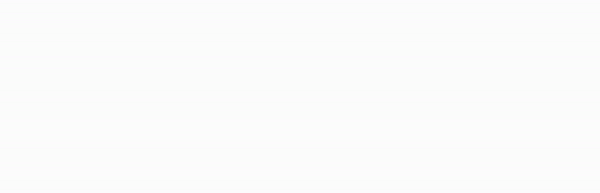

# reinholding.com

The landing page of reinholding.com. The word "Reinholding" draws itself, then redraws every four seconds with a new colour shift and line texture.

## How it is built

The whole site is two static files in `site/`: `index.html` (animation, about, work, contact) and `imprint/index.html` (legal notice, served at `/imprint/`). The animation is an inline SVG, CSS keyframes and a few lines of JavaScript. There is no build step and no dependency. To preview, serve the folder (`python3 -m http.server -d site 8000`) and open http://localhost:8000/. Opening the files directly does not resolve the `imprint/` folder address.

- The draw animation is a `stroke-dashoffset` keyframe on a mask.
- Colours and textures (dash, hatch) change on each loop in the script at the bottom of the file.
- With `prefers-reduced-motion` the word is shown fully drawn in black and nothing moves.

## Deployment

Every push to `main` uploads `site/` to the hosting provider over FTPS, see `.github/workflows/main.yml`.